<p align="center">
  
</p>

<h1 align="center">AIDE — AI-Driven Code Editor</h1>

<p align="center">A desktop editor built as a native shell for AI coding agents.</p>

<p align="center">
  <a href="LICENSE"></a>
  
  
  <a href="https://github.com/Allexin/AIDE/releases/latest"></a>
</p>

<p align="center">
  <a href="https://github.com/Allexin/AIDE/releases/latest"><b>⬇ Download for Windows</b></a>
  &nbsp;·&nbsp;
  <a href="https://get-aide.org"><b>get-aide.org</b></a>
</p>

<p align="center">
  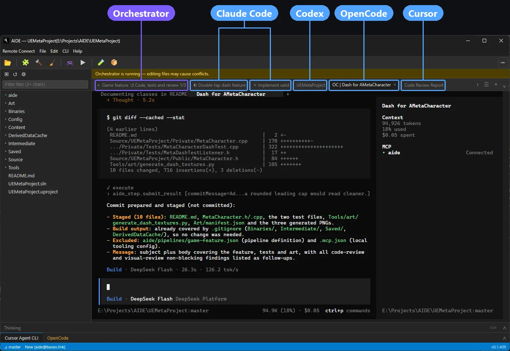
</p>

## One sentence in. A working setup out.

Tell the agent what you want. AIDE gives it the tools to wire up your workspace.

### “I want all my agents in one window”

Claude Code, Codex, Cursor Agent, OpenCode and more run as real terminal sessions in tabs, next to the editor, the file tree and git. Several sessions of the same CLI, each with its own title, resumed on startup.

<details>
<summary>Four agents at work on one Unreal Engine project</summary>

| | |
|---|---|
| 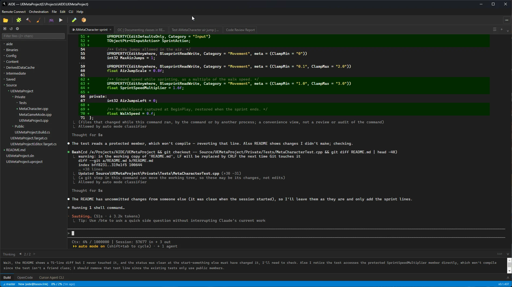<br>Claude Code adds a sprint to the character… | 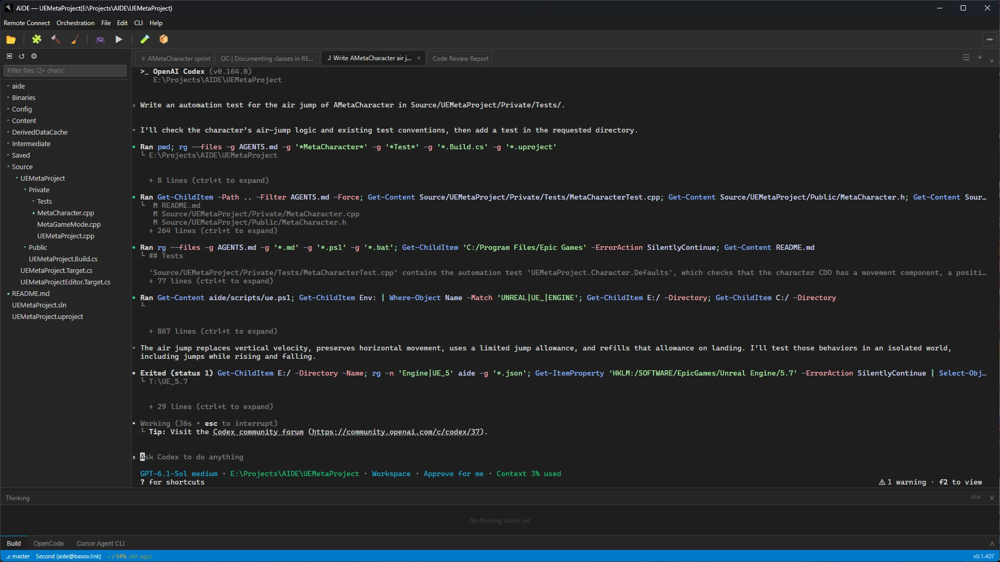<br>…Codex writes an automation test… |
| 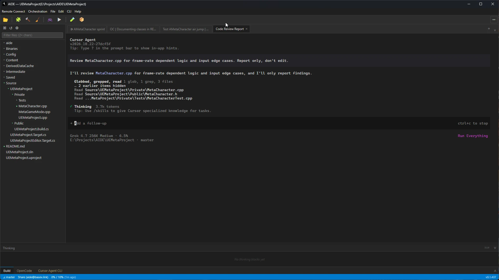<br>…Cursor Agent reviews for frame-rate bugs… | 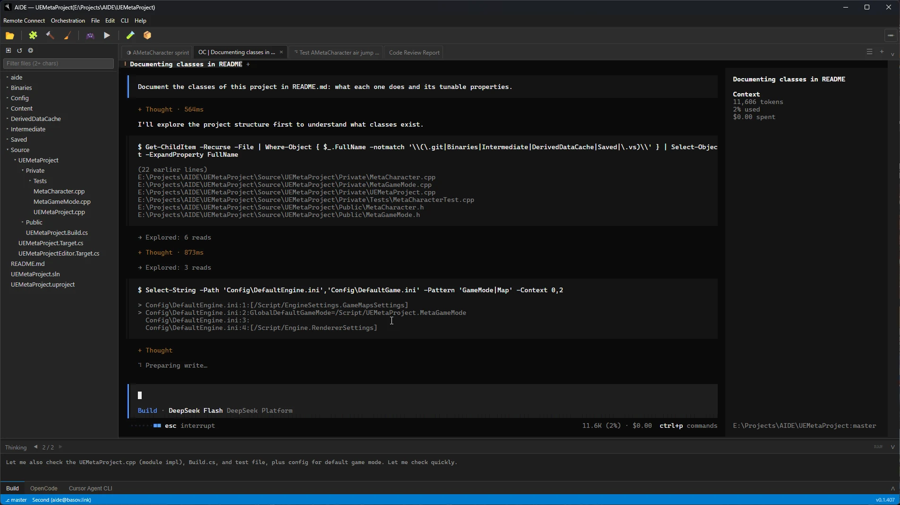<br>…and OpenCode documents the classes. |

</details>

### “I want a toolbar”

| You say | You get |
|---|---|
| 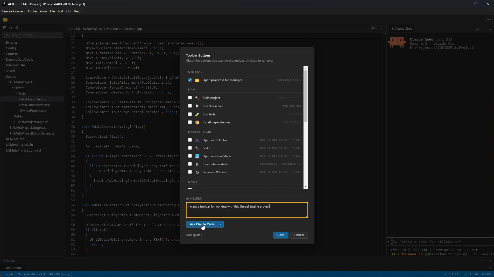 | 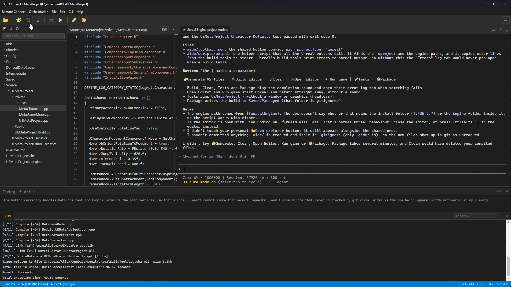 |
| *I want a toolbar for working with this Unreal Engine project* | Build, clean, run, test, package: one click each, output in the log. |

### “I want to control it from my phone”

Remote Connect: scan the QR code or open the link, and the same session continues in a phone or any browser.

| In AIDE | In a browser | On a phone |
|---|---|---|
| 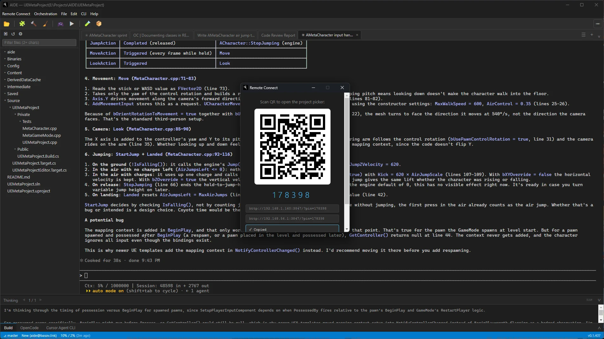 | 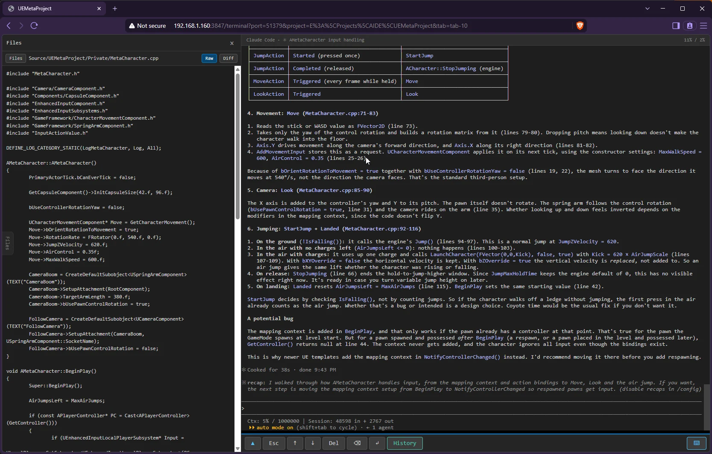 | 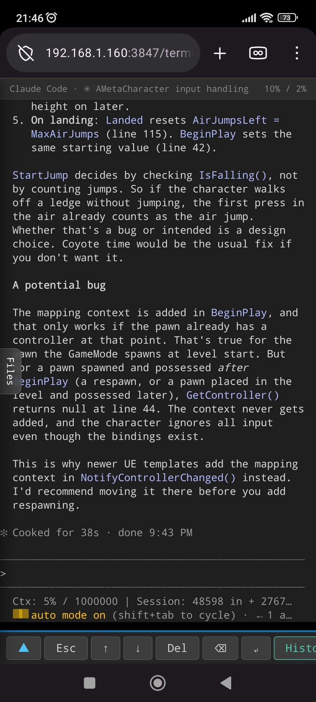 |
| Scan the QR or open the link. | The same session, plus the project files. | The same session, with keys to drive it. |

### “I want an orchestra”

| You say | You get |
|---|---|
| 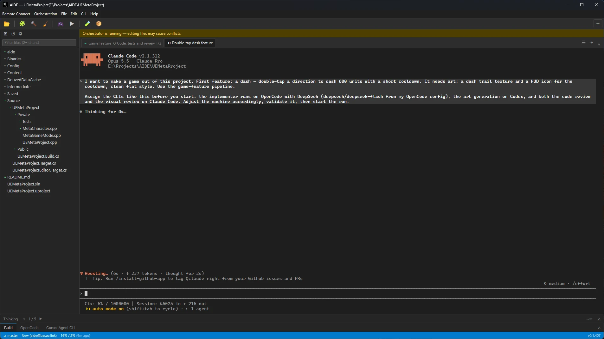 | 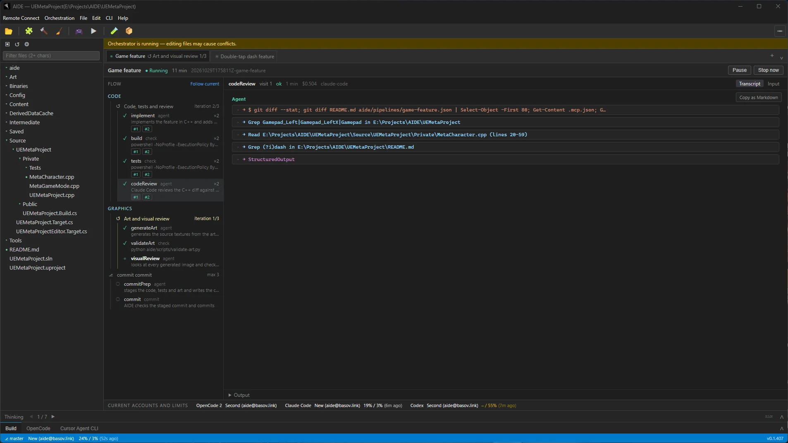 |
| *I want to make a game out of this project. First feature: a dash, with a trail texture and a HUD icon.* | OpenCode codes, Claude reviews, Codex draws: code → tests → review → art → visual review → commit. |

## Getting started

1. [Download the latest release](https://github.com/Allexin/AIDE/releases/latest): a portable build, nothing to install.
2. Unpack it anywhere and run `AIDE.exe`.
3. Open a project folder. AIDE starts an agent session in it.

The agent CLIs themselves (Claude Code, Codex, …) need to be installed and signed in; AIDE finds them on `PATH`.

## Supported agents

`Claude Code` · `Codex` · `Cursor Agent` · `Devin` · `OpenCode` · `Qwen Code` · `Terminal` · **+ any other**

Missing yours? Ask your agent to add itself to AIDE: there is a [step-by-step guide](docs/new-cli-tool-spec.md), and any top model handles it.

## Features

<details>
<summary><b>Agent CLIs</b>: tabs, sessions, accounts, history</summary>

- **Session tabs**: real terminals (xterm.js + node-pty); sessions resume on startup, titles persist, the session picker opens any past session
- **Session binding**: every tab is bound to its CLI session deterministically
- **Accounts**: several per CLI, hot switching, usage and limits display; proxy settings applied to every CLI
- **Thinking panel**: the agent's extended reasoning, live
- **History viewer**: any past session rendered as Markdown
- **Smart compact** for direct CLI sessions

</details>

<details>
<summary><b>Pipelines and orchestration</b>: deterministic multi-agent flows</summary>

- **Pipeline machines**: per-task-type flows in `aide/pipelines/*.json`, a tree of steps (agents, checks, gates, loops, groups, `if`, commit) that AIDE executes deterministically. Each agent runs headless with its role, sees the whole pipeline with "you are here", and gets loop feedback automatically
- **Orchestrator over MCP**: any agent CLI with MCP support connects to AIDE, set up automatically with nothing to configure, and decides what to run: picks tasks, starts machines, answers escalations, reads reports
- **Run view**: the step tree, live transcripts, check logs, pause / stop / resume, escalation answers and the final report
- **Robust runs**: run state is saved after every step and survives an AIDE restart

</details>

<details>
<summary><b>Editor and project</b>: Monaco, diff, git, toolbar</summary>

- **Monaco Editor**: auto-save on focus loss, external-change conflict dialog, large file confirmation
- **Diff view**: HEAD vs disk, to review what the agent changed
- **File tree**: live git status, "modified only" filter, fast filtering
- **Git**: branch and file status in the status bar, commit dialog with streamed progress
- **Toolbar as code**: project and personal buttons in `toolbar.json`; the agent writes them, you click them, output lands in log channels
- **Shared projects**: per-user state under `.aide/users/<user>/`, so several people can work in one project folder (e.g. over SMB)

</details>

<details>
<summary><b>More</b>: remote access, updates, diagnostics</summary>

- **Remote access**: continue a session from a phone, tablet or any browser via a QR code ([`docs/remote-access.md`](docs/remote-access.md))
- **Updates**: in-app update check against GitHub releases
- **Crash diagnostics**: an event trail that survives a crash ([`docs/crash-diagnostics.md`](docs/crash-diagnostics.md))
- **Unreal Engine** project discovery

</details>

## Command line

```
aide [<projectPath>] [options]
aide --project <projectPath> [options]

  --no-restore         Exclude saved AIDE tabs from startup suggestions
  --cli <toolId>       Use this CLI for the initial tab during this launch only
  --no-global-state    Do not touch recent projects or saved open sessions
  --help, -h           Show help
```

Without a path AIDE opens the project picker; started inside a folder with `.aide/` it opens that project directly.

## Development

Building from source, tests, packaging and the code layout: [`docs/development.md`](docs/development.md). Linux builds are implemented and awaiting on-device testing.

## License

[MIT](LICENSE)
